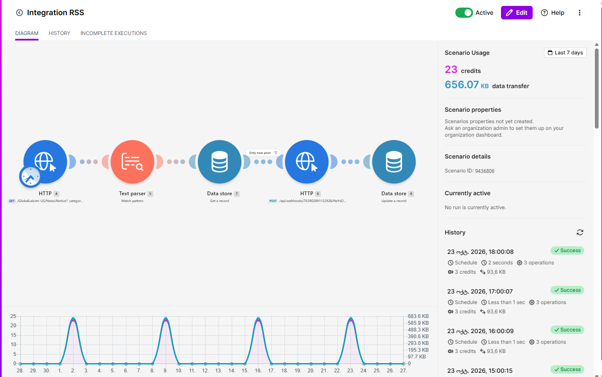
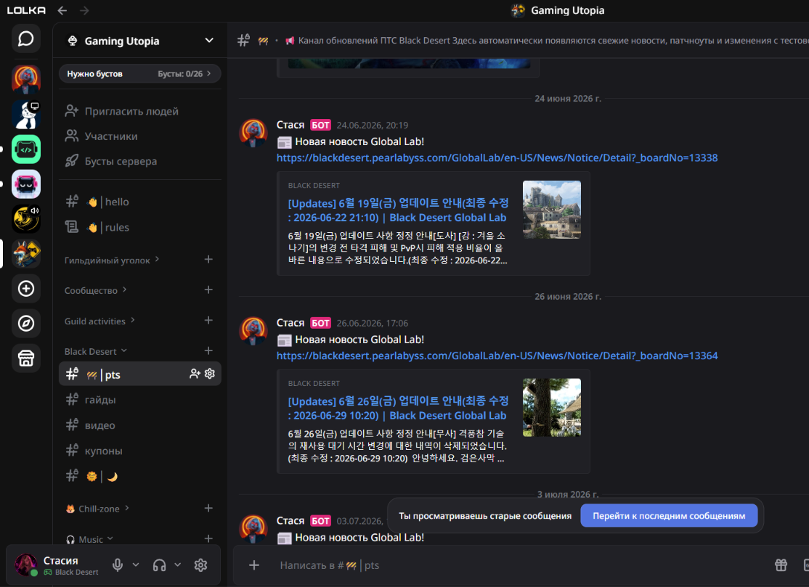

# 🎮 BDO Patch Notifier & Automated Monitor

An automation project for monitoring **Black Desert Online (Global Lab)** updates and sending notifications to the Lolka chat.

This is a personal project that I designed and configured in Make with the assistance of an AI assistant. I defined the automation logic, tested its behavior, identified a duplicate notification issue, and improved the mechanism for checking previously processed publications.

---

## 🎯 Project Goal

The scenario checks the official game website on a schedule, retrieves publication data, checks whether each publication has already been processed, and sends a notification to Lolka if it is new.

This reduces the need to monitor game news manually and helps prevent previously processed publications from being sent repeatedly.

---

## 🛠️ Tools and Technologies

- **Make (Integromat)** — building and configuring the automation scenario.
- **HTTP (GET/POST)** — retrieving website data and sending notifications.
- **Text Parser / RegEx** — extracting required data from HTML.
- **Make Data Store** — storing processed publication IDs and checking for duplicates.
- **Webhooks** — transferring data for notification delivery.
- **JSON** — data exchange format.

---

## 🧪 QA & Testing

### 1. Data Extraction and Validation

Extracting the publication identifier (`boardNo`) from the HTML page and using it to distinguish new publications from previously processed ones.

### 2. Duplicate Prevention

Using Make Data Store to store identifiers of processed publications. Checking whether an identifier already exists allows the scenario to skip previously processed publications.

### 3. Integration Testing

Checking the data processing flow across the main components:

1. Retrieve data from the source website.
2. Extract the publication identifier.
3. Check the stored publication IDs.
4. Filter out previously processed publications.
5. Send a notification to Lolka.

### 4. Defect Identification and Fix

During testing, I identified an issue that caused the same publication to be sent repeatedly. I improved the logic for checking previously processed publications and tested the scenario again to verify that duplicate notifications stopped under the conditions checked.

---

## 📸 Project Demo

### 1. Automation Scenario in Make

*Data processing flow: schedule → HTTP request → parsing → Data Store lookup → duplicate filtering → notification delivery.*

### 2. Notification in Lolka

*Example of a game update notification delivered to the Lolka chat.*

---

## 📌 Project Type

Personal project / Low-code automation

## 👩‍💻 My Contribution

- Defined the automation logic and processing flow.
- Configured the Make scenario with the assistance of an AI assistant.
- Tested individual steps and the overall scenario.
- Identified the duplicate notification issue.
- Improved the duplicate-checking logic and verified the result.
